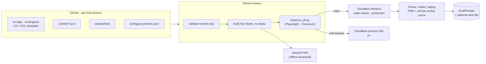

# AaryaAI – Architecture

AaryaAI is a learning app for children in Klasse 1 (Deutsch, Mathe, English, हिंदी, मराठी, Training, Heft-Zeit).
It must work **offline**, keep **all data on the child's device**, and be simple for parents to open on a phone or laptop.

## 1. Principles

| Principle | What it means in practice |
|---|---|
| Offline first | One self-contained HTML file (fonts embedded). The hosted version adds a service worker so it also opens without internet. |
| Privacy by design | No accounts, no server-side data, no tracking. Progress lives in the browser (localStorage) plus an optional save file chosen by the parent. |
| Learning before play | Daily Lernplan (read · spell · write · maths) unlocks games; reading pause and typed answers stop guessing. |
| One language per area | English area 100 % English, Deutsch/Mathe 100 % German, Hindi/Marathi with selectable instruction language and native voices only. |
| Content is data | Texts, words and prompts are JSON, checked by a validator before every build. |
| Every change is tested | ~230 Playwright checks run in CI before anything is deployed. |

## 2. Overview



## 3. Repository layout

```
src/app/            app shell, subjects, learning plan, Hindi/Marathi, PWA client, boot (setup wizard, save file, migrations)
src/engines/math/   shared practice engine + Mathe units (also used by Deutsch)
src/engines/deutsch Deutsch units
src/pwa/            service worker, manifest, icons, Cloudflare _headers
src/legacy-patches.json   exact-match patches that adapt the legacy engines (phase 2 removes them)
content/learn/      read.json · spell.json · write.json
assets/fonts/       Andika, Fredoka, Noto Sans Devanagari (OFL), embedded at build time
scripts/            build.mjs, validate-content.mjs
tests/              Playwright suites + run_all.py
docs/               this file
```

## 4. Build

`npm run build` → `validate-content.mjs` → `build.mjs` → `dist/`

| Output | Purpose |
|---|---|
| `index.html` | hosted app; links the manifest; registers `sw.js` |
| `AaryaAI.html` | same app for download / offline use (no service worker) |
| `sw.js` | cache-first service worker; its version string changes on every build |
| `manifest.webmanifest`, `icon*` | installable app ("Zum Startbildschirm hinzufügen") |
| `version.json` | `{version, build, date}` – shown in the parent area |
| `_headers` | Cloudflare: no-cache for `index.html`, `sw.js`, `version.json`; basic security headers |

The build is plain Node (≥ 18) with **zero npm dependencies**. `node scripts/build.mjs --legacy` reproduces the pre-migration file byte for byte (used to prove the Python → Node port changed nothing).

## 5. Runtime

- **Modules today:** IIFE globals – `PROF` (profile, languages), `REW` (points, levels, badges), `EN`/`MA`/`DE` (subject engines), `BR` (training), `NB`/`NBM` (notebook), `TALK` (speaking), `PLAN`/`GUARD`/`KP`/`READ`/`SPELL`/`WRITE` (learning first), `BH` (Hindi/Marathi), `PWA`, `STORE` (save file).
- **Scoring:** single entry point `REW.hit(subject, kind, n)`.
- **Storage:** localStorage keys listed in `AAI.KEYS`; `aaryaai-schema` holds the data schema version. `AAI.MIGRATE[n]` upgrades data once per device (a backup is written first).
- **Updates (PWA):** new deploy → browser installs the new service worker in the background → banner "Neue Version … Aktualisieren / Später" → only after OK: `SKIP_WAITING`, reload, old cache deleted. Checks every 30 min and when the app comes back to the foreground.
- **Speech:** Web Speech API (synthesis + recognition). Hindi/Marathi content is only spoken by a native `hi-*` / `mr-*` voice, never by a fallback voice.

## 6. Hosting – Cloudflare

Static assets on **Cloudflare Workers** (`wrangler.jsonc`, no server code).

| Branch / event | Result |
|---|---|
| push to `main` | tests → `wrangler deploy` → production (`aaryaai-kids.<account>.workers.dev`, custom domain optional) |
| pull request | tests → `wrangler versions upload --preview-alias pr-<n>` → preview URL |
| tests fail | nothing is deployed |

**One-time setup (owner):**
1. Cloudflare dashboard → *My Profile → API Tokens → Create Token* → template **"Edit Cloudflare Workers"**.
2. GitHub repo → *Settings → Secrets and variables → Actions* → add `CLOUDFLARE_API_TOKEN` and `CLOUDFLARE_ACCOUNT_ID` (Account ID is on the Cloudflare dashboard home, right column).
3. Optional: *Workers → aaryaai-kids → Settings → Domains & Routes* → custom domain (e.g. `kids.aaryaai.dev`).

Until the secrets exist, CI still validates, builds and tests; the deploy job is skipped with a warning.

## 7. Quality gates

| Gate | Tool |
|---|---|
| Content rules (answer really in the text, 3 different options, der/die/das, capitals, sentence length) | `scripts/validate-content.mjs` |
| Legacy patch drift | `build.mjs` fails if any patch no longer matches |
| Scoring, integration, review, notebook mode, Hindi/Marathi, tracing, learning plan, workbook generators, speaking checker, PWA update | `tests/*.py` via `run_all.py` |
| Layout at 360 px – laptop, tap targets, contrast | `tests/ux_test.py` (audit, run manually) |

## 8. Roadmap

**Phase 1 – done (this change):** Node build, content JSON + validator, PWA with update prompt, schema/migrations hook, CI, Cloudflare deploy, version in parent area.

**Phase 2 – modules & types**
- Vite + TypeScript, ES modules instead of globals; `vite-plugin-singlefile` keeps the one-file offline download.
- One shared **question engine** (`Question = {prompt, visual, answer, options?, input: "choice"|"number"|"tiles"|"trace"|"speech", why}`) used by Mathe, Deutsch, English, Hindi/Marathi and Lernplan – removes `legacy-patches.json`.
- Unit/lesson content of Mathe, Deutsch, English and Hindi/Marathi to JSON (generators stay code), with JSON-Schema.
- Vitest for generators and the speaking checker; Playwright tests moved to `@playwright/test`.

**Phase 3 – data & learning intelligence**
- IndexedDB store with typed, versioned records; export/import stays the save-file format.
- Spaced repetition (Leitner boxes) across subjects: mistakes come back after 1, 3, 7 days.
- Parent report from real learning data (reading accuracy, spelling errors by letter, maths facts not yet automatic).
- Optional, opt-in only: family sync via Cloudflare Workers + D1 (parent account, no child account), and bring-your-own-AI key for free-form writing and speaking feedback. Privacy review (GDPR, children's data) before either ships.

## 9. Decisions

| # | Decision | Why |
|---|---|---|
| 1 | Single-file app, embedded fonts | works from a USB stick, email attachment or Claude artifact; no broken paths offline |
| 2 | No backend | children's data stays at home; zero running cost; nothing to secure |
| 3 | Cloudflare Workers static assets | free tier, global CDN, preview URLs per PR, `_headers`, room for Workers/D1 later |
| 4 | Node build with zero deps | builds anywhere (CI, Cloudflare, a laptop) without `npm install`; fast |
| 5 | Patches kept as data during migration | proves byte-identical output now; patch drift fails the build; removed in phase 2 |
| 6 | Update only after OK | a child mid-exercise is never interrupted by a reload |
